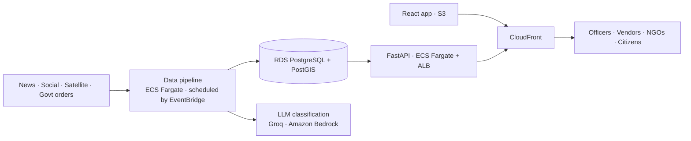

# JalJeevan

Real-time water-crisis intelligence for India. JalJeevan tracks drought, floods, heat and water-supply failures at taluka level and helps relief officers, tanker vendors and NGOs respond.

**Live:** https://d77gmqy6y3kav.cloudfront.net
**Track:** Heat and Water · WeMakeDevs × AWS Environmental Hacks

---

## Features

- **Live hazard map:** drought, flood, heat and water-supply zones across India on an interactive globe, with a live feed of incoming reports.
- **Zone intelligence:** each zone has a severity score, the supporting evidence, and measured drought indicators (rainfall, soil moisture, official declarations).
- **Drought footprint:** per-taluka assessment based on the Government of India Drought Manual, with affected population counted from a 1 km population grid.
- **Official declarations:** automatic extraction of state drought orders from government PDFs (including Marathi), plus a news-based watch for other states.
- **Relief briefs:** AI-drafted situation summaries with computed water need, tanker trips and budget, approved by a relief officer.
- **Tanker tenders:** tenders matched to the nearest vendors, with private negotiation (accept, counter, decline, message) and committed-supply tracking.
- **Community:** NGO fundraising campaigns and volunteer tasks.
- **Long-term plans:** costed water-security plans per zone, with a printable summary.
- **Accounts and notifications:** role-based access for officers, vendors, NGOs and citizens, with in-app notifications.
- **Light and dark themes.**

## Data sources

| Source | Used for |
|---|---|
| GDELT, RSS news feeds | News reports |
| Reddit, X | Citizen reports |
| CHIRPS (satellite rainfall, SPI) | Drought rainfall indicator |
| Copernicus GDO | Soil moisture anomaly |
| WorldPop 2025 (1 km) | Population estimates |
| geoBoundaries | District and taluka boundaries |
| State government orders | Official drought declarations |

## Architecture



The pipeline runs twice a day: **ingest → indicators → declarations → classify → geocode → zones**.

## Tech stack

| Layer | Technologies |
|---|---|
| Frontend | React 19, TypeScript, Vite, TanStack Query, Tailwind CSS, MapLibre GL, deck.gl, three.js |
| Backend | Python 3.13, FastAPI, SQLAlchemy 2, GeoAlchemy2, PostGIS, rasterio, pdfplumber |
| AI | Groq (gpt-oss-120b), Amazon Bedrock (Nova) |
| Infrastructure | AWS CDK (Python) |
| Testing | pytest, Vitest, Testing Library, Playwright |

## AWS services

All resources run in `ap-south-1` (Mumbai) and are defined as code in `infra/`.

| Service | Purpose |
|---|---|
| Amazon CloudFront | Content delivery and a single HTTPS endpoint for web and API |
| Amazon S3 | Frontend hosting and raw data archive |
| Amazon ECS (Fargate) | API service and scheduled pipeline tasks |
| Elastic Load Balancing | Load balancer for the API |
| Amazon RDS for PostgreSQL | Geospatial database (PostGIS) |
| Amazon EventBridge | Pipeline scheduling |
| AWS Secrets Manager | Application secrets and database credentials |
| Amazon Bedrock | LLM inference |
| Amazon Location Service | Geocoding |
| AWS Certificate Manager | TLS certificate for the custom domain |
| Amazon ECR | Container registry |
| Amazon Polly | Demo video narration |

## Getting started

**Prerequisites:** Docker, [uv](https://docs.astral.sh/uv/), Node.js 20+

```bash
# Database
docker compose up -d db

# Backend
cd backend
uv sync
uv run python -m app.cli.seed_geo        # load boundaries and gazetteer
uv run python -m app.cli.seed_crm        # demo organisations and accounts
uv run python -m app.cli.run_pipeline    # run the pipeline once
uv run fastapi dev                       # http://localhost:8000

# Frontend
cd ../frontend
npm install
npm run dev                              # http://localhost:5173
```

Create `backend/.env` with:

```
GROQ_API_KEY=
APIFY_TOKEN=
ADMIN_TOKEN=
JWT_SECRET=
DEMO_PASSWORD=
AWS_PROFILE=
```

## Testing

```bash
cd backend && uv run pytest -q              # unit, service and API tests
cd frontend && npx vitest run               # component tests
cd frontend && npx playwright test          # end-to-end and accessibility
```

## Deployment

```bash
cd frontend && npm run build
cd infra && npx cdk deploy
```

## Project structure

```
backend/
  app/
    api/            REST endpoints
    domain/         business rules
    services/       pipeline, zones, tenders, briefs, plans, community
    repositories/   data access
    integrations/   external data sources and AI providers
    cli/            seeding and pipeline commands
  tests/
frontend/
  src/features/     landing, map, zones, tenders, briefs, plans, community, account, ops
  e2e/
infra/              AWS CDK stack
```

## Team

- **Sujal Kumar Singh**: data pipeline, drought intelligence, AWS infrastructure
- **Chetan Kumar S M**: frontend and UX
- **Taran Pal Singh**: relief management (tenders, briefs, community, plans)
