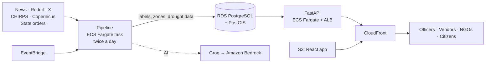

# JalJeevan

A live map of India's water crisis: drought, floods, heat and broken water supply. It reads the news, satellite data and government orders every day, shows where people need water, and helps officials send tankers there.

**Stack:** FastAPI · PostgreSQL + PostGIS · React 19 · MapLibre + deck.gl · three.js · AWS (CDK, Fargate, RDS, CloudFront)
**Live:** https://d77gmqy6y3kav.cloudfront.net  ·  Built for the WeMakeDevs × AWS Environmental Hacks, Heat and Water track.

* * *

## Contents

- [What it does](#what-it-does)
- [Numbers](#numbers)
- [What's underneath](#whats-underneath)
- [How it fits together](#how-it-fits-together)
- [Who can do what](#who-can-do-what)
- [Run it](#run-it)
- [Check that it works](#check-that-it-works)
- [Built on AWS](#built-on-aws)
- [Decisions worth explaining](#decisions-worth-explaining)
- [Project layout](#project-layout)
- [Team](#team)

* * *

## What it does

| Screen | What happens there |
|---|---|
| **Landing** | A 3D model of India built from real terrain. Live zones glow on it. One plain story about the problem. |
| **Live map** | Every zone for drought, flood, heat and water supply, with a live feed of new posts. Light and dark mode. |
| **Zones** | A ranked list of where help is needed. Each zone page shows its score, the posts behind it word for word, and the drought data. |
| **Tenders** | A relief officer asks for drinking water. The nearest tanker owners answer with their price. Offers stay private. |
| **Briefs and plans** | The AI writes a short relief brief or a long-term plan in plain words. Code computes every number. An officer approves it. |
| **Community** | NGOs raise pledges and ask for volunteers for a village. |
| **Ops** | Pipeline health: what ran, what failed, how fresh the data is. |

* * *

## Numbers

| | |
|---|---|
| Talukas on the map | **6,822** (each one has a boundary) |
| Live zones today | **246 active**, 29 on watch |
| People in active zones | **9.3 crore**, counted only where it is actually dry |
| Maharashtra drought order read automatically | **230 of 265** talukas matched, **0** wrong (checked against the order's own district counts) |
| Posts read in the last 7 days | **353**, from news, Reddit, X and citizens |
| Backend tests | **367** (pytest, real PostGIS database) |
| Frontend tests | **60** unit + **11** end-to-end and accessibility |
| Page size | every route under **250 KB** gzip |
| Deploy time | **1–5 minutes** with one command |
| Running cost | about **$60 a month** on AWS |

* * *

## What's underneath

Each row is one mechanism. The last column says what happens when its source fails, because sources do fail.

| Mechanism | How it works | When its source is down |
|---|---|---|
| **News and social media** | GDELT, RSS, Reddit and X, twice a day. Old posts and copies are dropped before any AI call. | That source is skipped; the run goes on. |
| **AI labels** | Groq `gpt-oss-120b` labels each post by hazard. Every quote must appear word for word in the post, or it is thrown away. | Falls back to Amazon Bedrock (Nova). If both fail, posts wait for the next run. |
| **Locations** | Place names are matched to a gazetteer, with Amazon Location as backup. | Unmatched posts stay off the map rather than being guessed. |
| **Drought data** | Satellite rainfall (CHIRPS SPI ≤ −1) and Copernicus soil moisture, per taluka, following the Government of India Drought Manual. | Data older than 20 days counts as *unknown*, not *fine*. Zones are held, not closed. |
| **People affected** | WorldPop 1 km grid. Only people in the dry cells are counted, not the whole district. | Falls back to the gazetteer population, and says so. |
| **Official orders** | State drought orders are read from PDFs, including Marathi with broken fonts. Names are transliterated and fuzzy-matched. | Doubtful names go to a check list. Nothing is guessed silently. |
| **Other states' orders** | A daily news watch. A taluka counts only if **1 official order** or **2 independent news sites** name it. | Rate-limited by GDELT? It retries after 2 hours. |
| **Relief briefs and plans** | The AI writes words only. Any sentence with a number is removed. Code computes litres, tanker trips and budget. | After 20 seconds a plain template is used. The numbers never depend on the AI. |
| **Tenders** | Vendors are ranked by distance, price, fleet size and reliability. Bids follow fixed rules, and each action is checked against the bid's version. | If two people act at once, one wins and the other is asked to reload. |
| **Notifications** | Private, per user: new tenders, replies, pledges. | The bell checks every 15 seconds. |

* * *

## How it fits together



- **One container image** runs both the API and the pipeline.
- **The database is private.** Only the API and the pipeline can reach it.
- **One HTTPS address** serves the site and the API, so there is no CORS.

* * *

## Who can do what

Anyone can read the map, zones, tenders and campaigns. Writing needs an account.

| Action | Citizen | Vendor | NGO | Relief officer |
|---|:-:|:-:|:-:|:-:|
| Sign up themselves | ✓ | — | — | — |
| Pledge, volunteer | ✓ | ✓ | ✓ | ✓ |
| Answer a tender (own company only) | — | ✓ | — | — |
| See offers on a bid | — | own bid | — | ✓ |
| Start campaigns, post tasks | — | — | ✓ | — |
| Draft and approve briefs and plans, publish tenders | — | — | — | ✓ |

Officer, vendor and NGO accounts are created by us, never by signing up. Demo accounts: `officer@relief.demo`, `solapur@vendor.demo`, `ngo@relief.demo` (password shared on request).

* * *

## Run it

You need Docker, [uv](https://docs.astral.sh/uv/) and Node 20+.

```bash
docker compose up -d db                       # PostGIS on port 5433
cd backend && uv sync
uv run python -m app.cli.seed_geo             # districts, talukas, places (one time, ~6 min)
uv run python -m app.cli.seed_crm             # demo office, vendors, NGO and accounts
uv run python -m app.cli.run_pipeline         # collect, label and build zones once
uv run fastapi dev                            # API on :8000

cd ../frontend && npm install && npm run dev  # app on :5173
```

Keys go in `backend/.env`: `GROQ_API_KEY`, `APIFY_TOKEN`, `ADMIN_TOKEN`, `JWT_SECRET`, `DEMO_PASSWORD`, `AWS_PROFILE`.

* * *

## Check that it works

```bash
cd backend && uv run pytest -q                     # 367 tests
cd frontend && npx vitest run                      # 60 tests
npm run build && npm run budgets                   # size budget per route
npx playwright test smoke a11y                     # end-to-end + accessibility, light and dark
```

* * *

## Built on AWS

Everything runs in Mumbai (`ap-south-1`) and is defined in `infra/` with the AWS CDK. One command deploys it; one removes it.

| Service | Job |
|---|---|
| CloudFront + S3 | The website, and one HTTPS address for site and API |
| ECS Fargate + Application Load Balancer | The API, and the scheduled pipeline from the same image |
| RDS PostgreSQL + PostGIS | All geo data, in private subnets |
| EventBridge | Runs the pipeline twice a day |
| Secrets Manager | API keys, session signing key, database password |
| Amazon Bedrock | AI fallback (Nova) |
| Amazon Location | Geocoding fallback |
| Certificate Manager | HTTPS for the custom domain |
| ECR | Container images |
| Amazon Polly | The voice in the demo video |

```bash
cd frontend && npm run build
cd infra && npx cdk deploy          # npx cdk destroy removes everything
```

* * *

## Decisions worth explaining

**Drought comes from data, not headlines.** One news article once made a whole district look dry. Now drought needs measured rainfall or soil data, and posts only confirm it.

**People are counted where it is dry.** Counting a whole district would make tanker and budget numbers wrong by lakhs.

**The AI writes words; code writes numbers.** Every litre, rupee and person on the site comes from arithmetic you can check. Numbers the AI writes are deleted.

**Nothing is guessed silently.** Unclear names, unclear states and doubtful matches go to a person to check.

**Bids are private.** The public sees who was invited and the status. Only the officer and that vendor see the price.

**No NAT gateway.** It would cost more than all our compute. Tasks use public subnets, and the database stays private.

**Everything optional degrades.** If a source, the AI or a data feed is down, the rest keeps working and the page says what is missing.

* * *

## Project layout

```
backend/
  app/
    domain/        pure rules: drought, scoring, matching, bids, playbook
    services/      pipeline, zones, tenders, briefs, plans, community
    repositories/  SQL, never commits
    integrations/  GDELT, Groq, Bedrock, CHIRPS, Copernicus, WorldPop, PDFs
    api/           FastAPI routes
    cli/           seed, pipeline, declarations
  tests/           domain, services, integrations, api
frontend/
  src/features/    landing, map, zones, tenders, briefs, plans, community, account, ops
  e2e/             Playwright smoke and accessibility tests
infra/             AWS CDK stack
```

* * *

## Team

| | Role |
|---|---|
| **Sujal Kumar Singh** | Lead. Data pipeline, drought data, AWS infrastructure. |
| **Chetan Kumar S M** | Frontend and UX. |
| **Taran Pal Singh** | Relief tools (tenders, briefs, community, plans) and the demo video. |
